<div align="center">

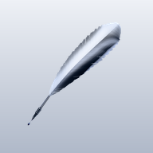

# Pluma Plateada

**Un cuaderno de poesía para el móvil: escribe, mide tus versos, crea tus libros y compártelos.**

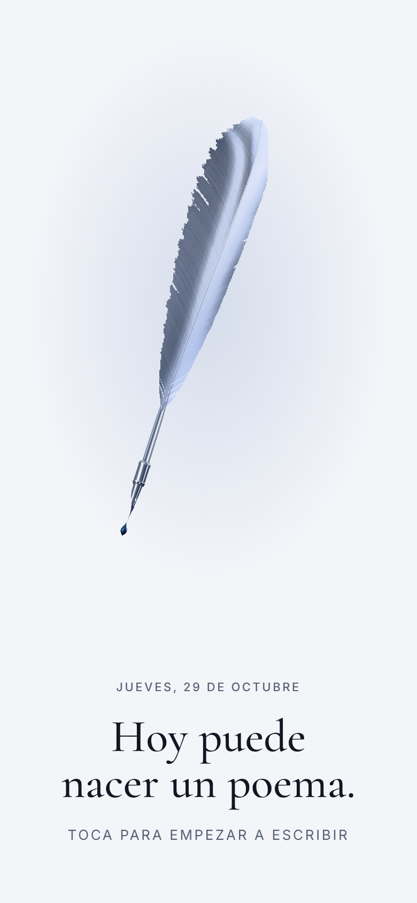&nbsp;
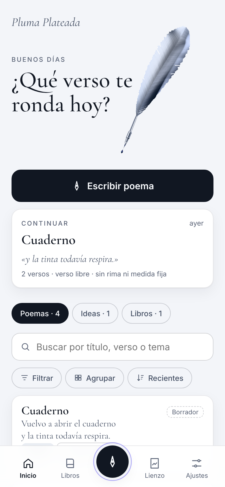&nbsp;
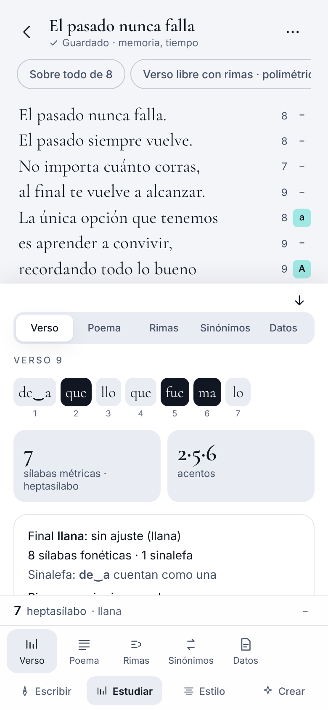

</div>

---

> ### Dedicatoria
>
> Herramienta desarrollada con cariño y con IA para mi gran amigo **Pluma Plateada**, que se merece lo mejor del mundo y un bonito recuerdo que lo transporte a aquella época en la que vivía sus emociones y experimentaba con el arte, parte de la esencia que tenemos como seres humanos. Como él mismo escribió:
>
> *«El pasado nunca falla. El pasado siempre vuelve.»*
>
> Espero que te guste este detalle, por si algún día quieres retomar tu versión más artística.
>
> — Lucks

---

## Índice

- [Qué es](#qué-es)
- [Instalarla en el móvil](#instalarla-en-el-móvil)
- [Qué puedes hacer](#qué-puedes-hacer)
- [Exportar y compartir](#exportar-y-compartir)
- [La marca en redes sociales](#la-marca-en-redes-sociales)
- [Tus poemas son tuyos](#tus-poemas-son-tuyos)
- [Para desarrolladores](#para-desarrolladores)
- [Créditos](#créditos)

## Qué es

Pluma Plateada es una aplicación web que se instala en el móvil como una app más. Está pensada para escribir sobre todo desde el teléfono, y también tiene un editor cómodo en el ordenador.

- **Funciona sin conexión.** Una vez instalada, no necesita internet.
- **No pide cuentas ni registros.** Todo se guarda en tu propio dispositivo.
- **Entiende la poesía en castellano.** Cuenta sílabas métricas, detecta rimas, reconoce estrofas y te ayuda con sinónimos.
- **Convierte tus poemas en algo que se puede tocar y compartir:** libros en PDF y ePub, imágenes y vídeos para redes.

## Instalarla en el móvil

La app vive en una dirección web y desde ahí se añade a la pantalla de inicio:

**https://luckstudio.github.io/pluma-plateada/**

<table>
<tr>
<th>📱 Android (Chrome)</th>
<th>🍎 iPhone / iPad (Safari)</th>
<th>💻 Ordenador (Chrome o Edge)</th>
</tr>
<tr valign="top">
<td>

1. Abre el enlace en **Chrome**.
2. Toca el menú **⋮** (arriba a la derecha).
3. Elige **Instalar aplicación** o **Añadir a pantalla de inicio**.
4. Ya tienes el icono de la pluma junto a tus apps.

También puedes instalarla desde **Ajustes → Instálala en el móvil → Instalar**, dentro de Pluma Plateada.

</td>
<td>

1. Abre el enlace en **Safari**. En otros navegadores de iPhone no se puede instalar.
2. Toca el botón **Compartir** (el cuadrado con la flecha).
3. Elige **Añadir a pantalla de inicio**.
4. Pulsa **Añadir**.

</td>
<td>

1. Abre el enlace.
2. Pulsa el icono de **instalar** en la barra de direcciones.
3. Se abrirá en su propia ventana, como un programa más.

</td>
</tr>
</table>

Una vez instalada:

- **Se abre a pantalla completa**, sin la barra del navegador.
- **Funciona en modo avión.**
- **Se actualiza sola** cuando hay una versión nueva.
- **Tus poemas no se borran al cerrarla.** La app pide al sistema que proteja su almacenamiento. Aun así, lee [Tus poemas son tuyos](#tus-poemas-son-tuyos).

## Qué puedes hacer

### ✍️ Escribir

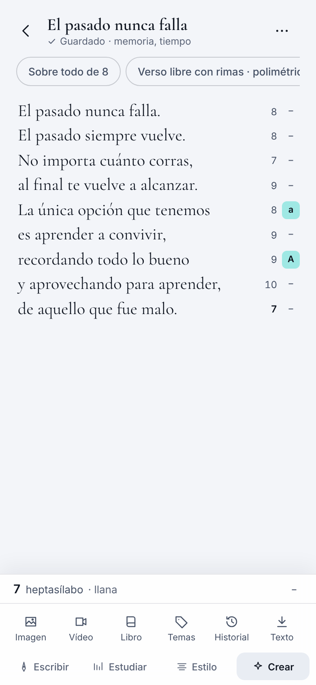

Escribir es lo primero, y el resto de herramientas queda a un toque.

- **Guardado automático** e **historial de versiones** para volver a cualquier borrador anterior.
- **Panel de herramientas** en la parte de abajo, pegado al teclado, con cuatro grupos:
  - **Escribir:** deshacer, rehacer, nueva estrofa, sangría, raya, comillas «», puntos suspensivos, ¿? y ¡!
  - **Estudiar:** análisis del verso y del poema, rimas, sinónimos y datos.
  - **Estilo:** alineación, tamaño de letra, mostrar u ocultar la métrica y **modo zen**, sin distracciones.
  - **Crear:** imagen, vídeo, añadir a un libro, temas, historial y exportar el texto.
- **Ideas rápidas:** una frase suelta que no quieres perder.
- **Temas** para etiquetar cada poema (amor, memoria, verano…).

<br clear="right">

### 📏 Medir los versos

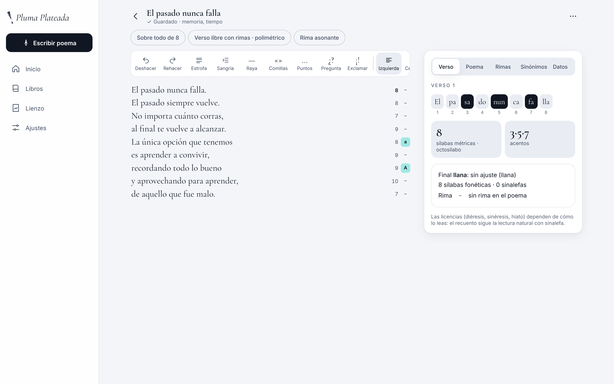

Junto a cada verso aparecen sus **sílabas métricas** y la **letra de su rima**. Al tocar un verso se ve el análisis completo:

- **Sílabas:** silabeo, **sinalefas** y **ley del acento final** (aguda +1, esdrújula −1).
- **Acentos:** posición de los acentos y tipo de verso (heroico, melódico, sáfico…).
- **Rima:** consonante o asonante, y esquema (mayúsculas para arte mayor, minúsculas para arte menor).
- **Forma:** reconoce **soneto, romance, redondilla, cuarteto, lira, décima, haiku**…
- **Palabras repetidas**, para pulir el texto.
- **Rimas y sinónimos sin conexión**, con el tesauro de LibreOffice.

### 🗂️ Organizar

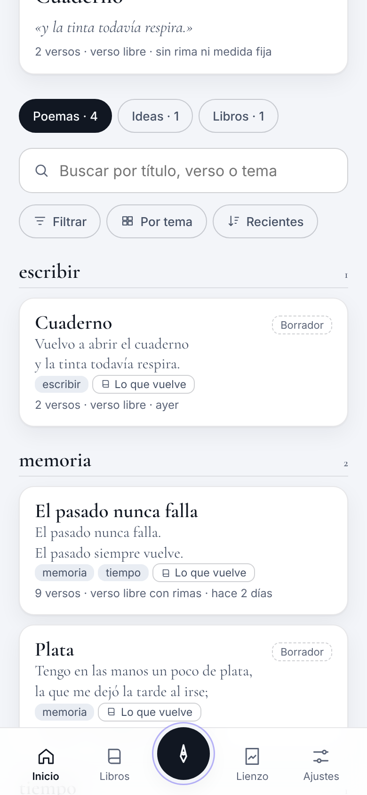

La biblioteca de Inicio permite encontrar cualquier poema al momento:

- **Búsqueda en tiempo real** por título, verso o tema.
- **Filtros:** borradores o terminados, temas, si está en algún libro (o en uno concreto), fecha y forma.
- **Agrupar** por tema, mes, libro, estado o forma.
- **Ordenar** por recientes, antiguos, título o longitud.
- **Cuatro estilos** de la app: **Plata** (claro, el de siempre), **Papel**, **Noche** y **Tinta**.

<br clear="right">

<p align="center">
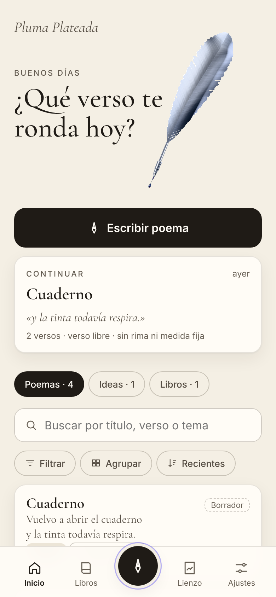&nbsp;
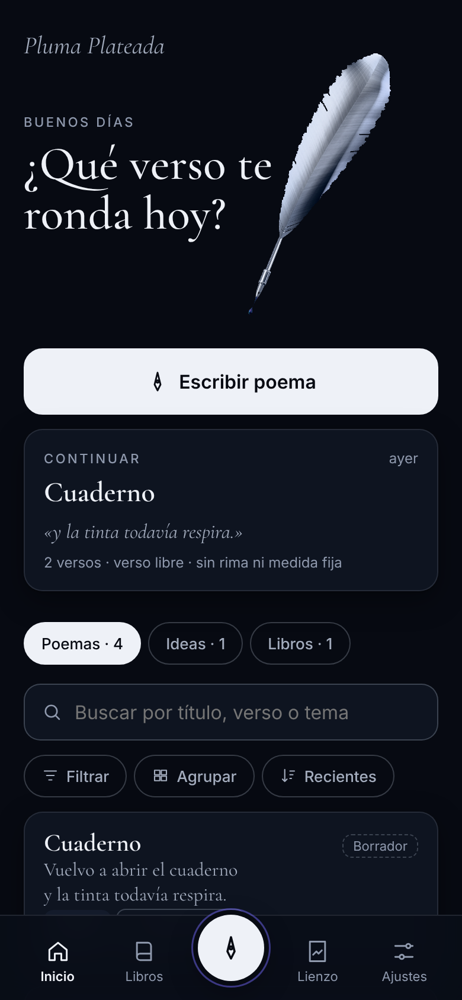&nbsp;
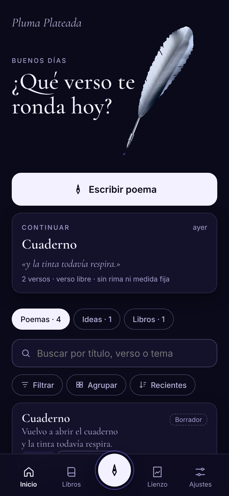
</p>

### 📖 Crear libros

<p align="center">
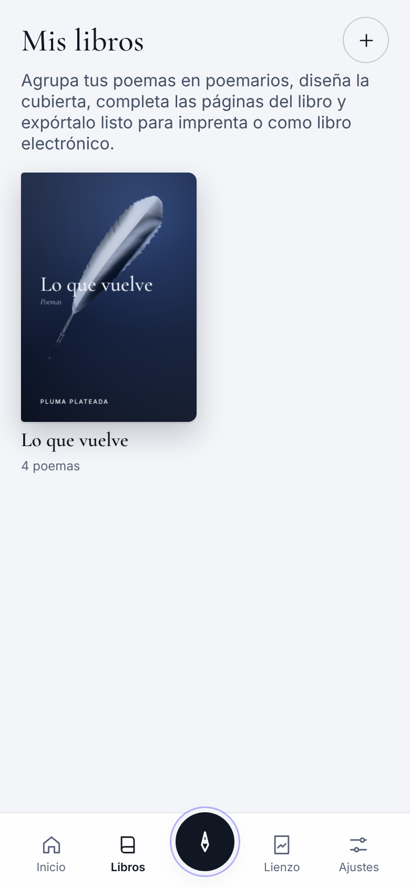&nbsp;
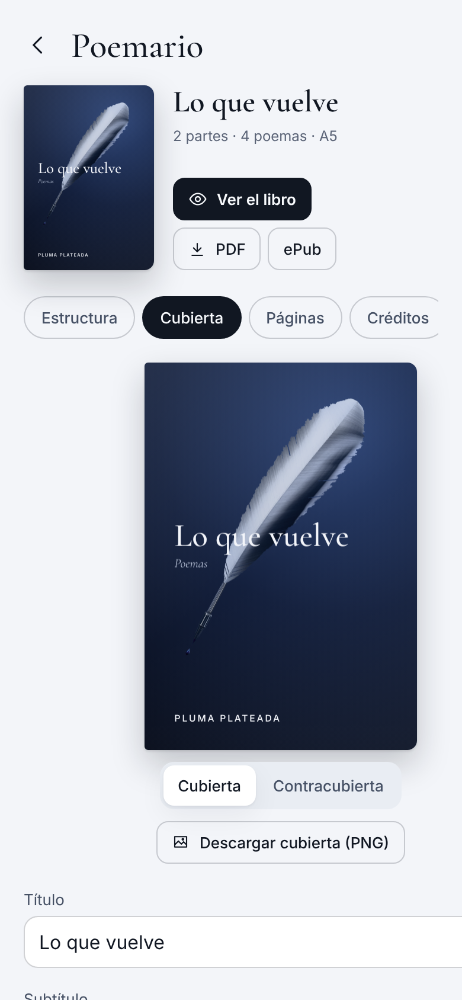&nbsp;
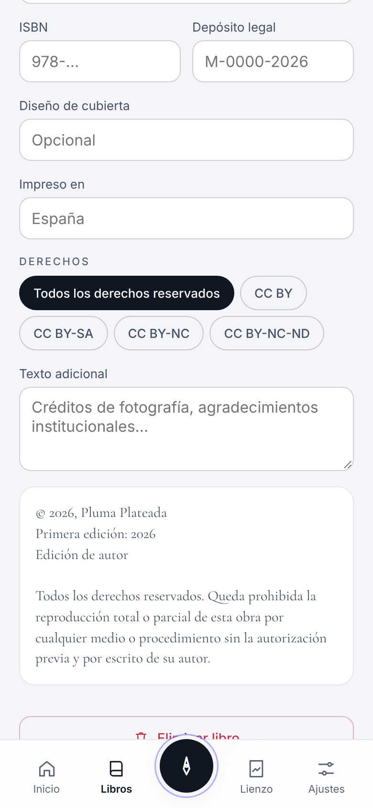
</p>

Reúne tus poemas en un **poemario** y prepáralo para imprenta o para leerlo en un lector electrónico:

- **Estructura:** partes y poemas que se reordenan arrastrando.
- **Cubierta y contracubierta:**
  - fondo Plata, Papel, Noche, Tinta, un color o **tu propia foto**;
  - tipografía y posición del título;
  - pluma decorativa;
  - texto de contraportada, biografía y código de barras con el ISBN.
- **Páginas del libro:** dedicatoria, epígrafe, prólogo, agradecimientos, sobre el autor y colofón.
- **Créditos legales:** año, edición, editorial, ISBN, depósito legal, diseño de cubierta, lugar de impresión y licencia (todos los derechos reservados o Creative Commons).
- **Maquetación cuidada:**
  - portadilla, portada e índice con la página real de cada poema;
  - las partes empiezan en página impar;
  - títulos de cabecera, numeración y control de estrofas que se parten entre páginas.
- **Vista previa** página a página, idéntica al PDF. En el ordenador se ve como un libro abierto.

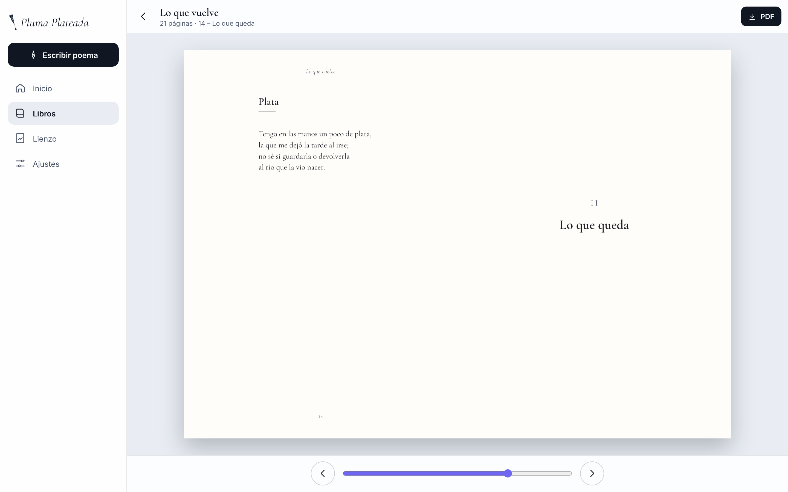

### 🎨 Lienzo: imágenes y vídeos

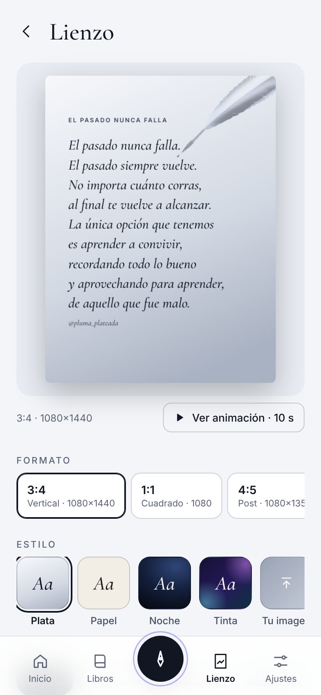

Elige los versos, el formato y el estilo, y obtén una pieza lista para publicar:

- **La vista previa se ve siempre arriba** y se hace más pequeña al bajar por los ajustes.
- **Formatos:** 3:4 (por defecto), 1:1, 4:5, 9:16, 16:9, postal, marcapáginas, A5 y A4.
- **Estilos:** Plata, Papel, Noche, Tinta o **tu propia imagen** de fondo.
- **Letra:** clásica, manuscrita, caligráfica o moderna.
- **Firma**, título y pluma decorativa opcionales.
- **Vídeo:** los versos aparecen uno a uno con un fundido. Puedes elegir:
  - la animación: fundido, ascenso o palabra a palabra;
  - el ritmo;
  - el final.

<br clear="right">

## Exportar y compartir

| Qué | Formato | Para qué |
| --- | --- | --- |
| Poema en imagen | **PNG** o **JPG** | Instagram, WhatsApp, estados |
| Poema en vídeo | **MP4** (H.264) | Reels, TikTok, Stories |
| Lámina o postal | **PDF de imprenta** con sangrado y marcas de corte | Imprimir y regalar |
| Libro completo | **PDF** con la tipografía incrustada | Imprenta o autoedición (Amazon KDP, Lulu…) |
| Libro electrónico | **ePub 3** con cubierta | Kindle, Apple Books, Kobo |
| Cubierta del libro | **PNG** en alta resolución | Promocionar el libro |
| Poema en texto | **TXT** | Copiar o pegar en cualquier sitio |
| Todo tu cuaderno | Copia de seguridad **`.pluma`** | Guardar o pasar a otro móvil |

En el móvil, al exportar se abre el menú de **Compartir** del sistema, y la pieza va directa a Instagram, WhatsApp o donde quieras.

## La marca en redes sociales

Cada pieza que sale de Pluma Plateada lleva la misma identidad, para que un poema se reconozca al verlo en el feed.

<p align="center">
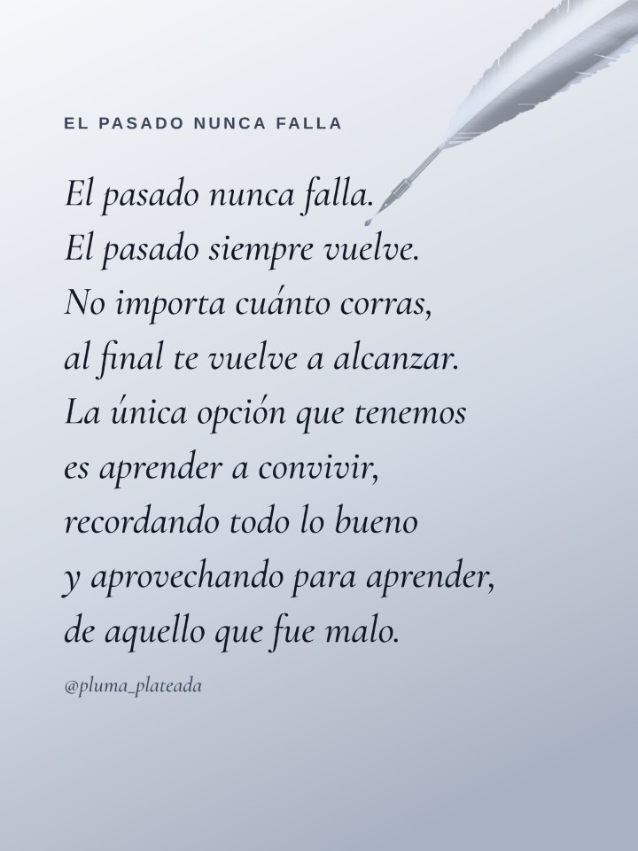&nbsp;
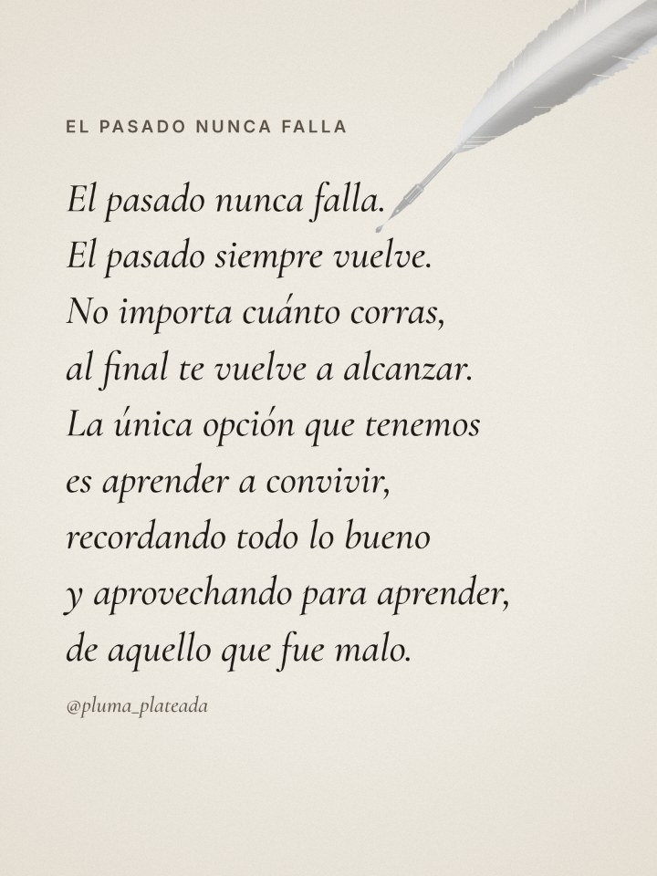&nbsp;
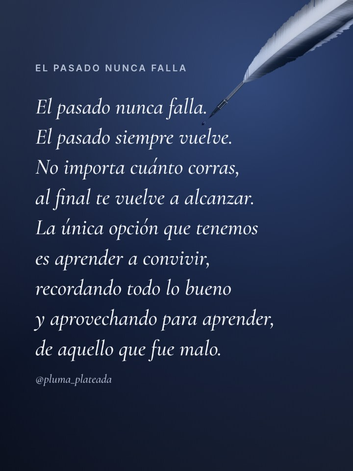&nbsp;
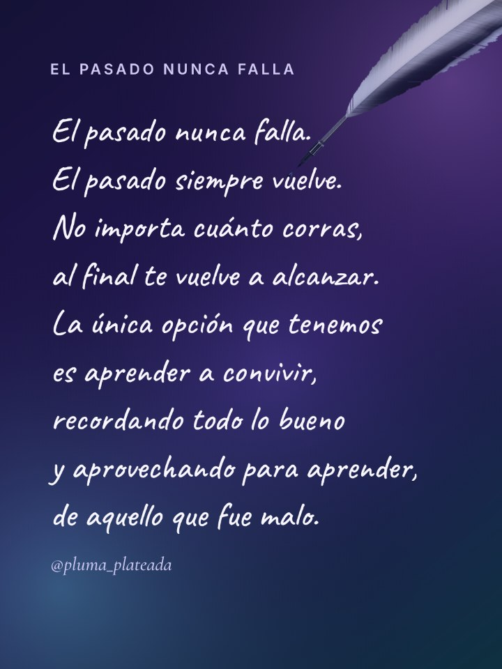
</p>

<p align="center">
&nbsp;&nbsp;
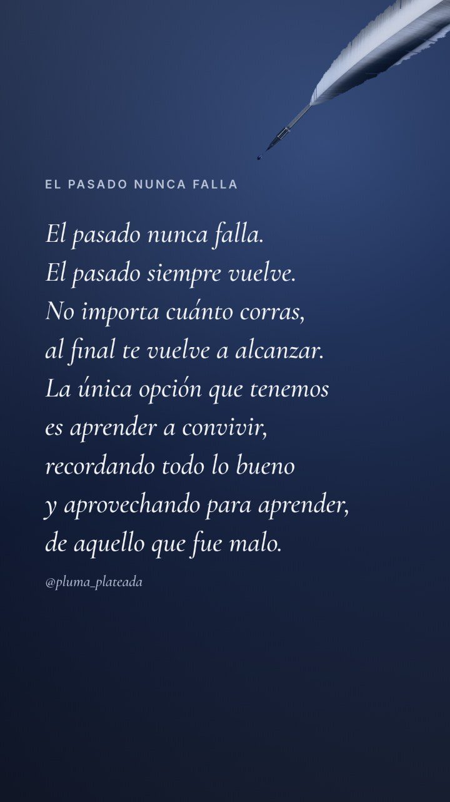&nbsp;&nbsp;
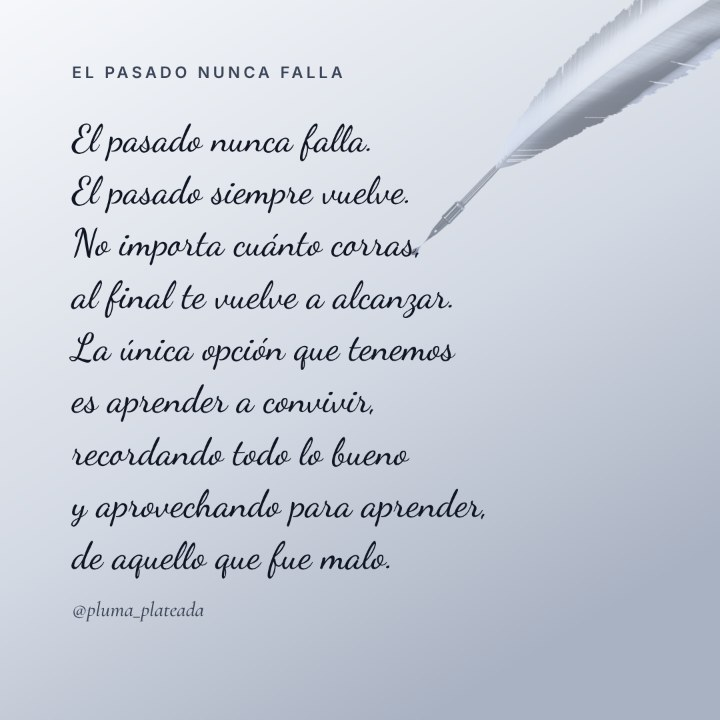
</p>

### Elementos de la marca

- **La pluma plateada.** Es el símbolo de la marca. Aparece en 3D al abrir la app y como detalle en la esquina de cada imagen, vídeo y cubierta.
- **La firma `@pluma_plateada`.** Va por defecto al pie de cada pieza. Se puede cambiar o quitar en el Lienzo.
- **Tipografía.** La principal es **Cormorant Garamond** en cursiva, con un aire clásico de libro. Para las etiquetas y los títulos pequeños se usa **Inter** en versalitas espaciadas.
- **Cuatro estilos**, que comparten nombre en la app, el Lienzo y las cubiertas:

| Estilo | Fondo | Texto | Carácter |
| --- | --- | --- | --- |
| **Plata** | `#eef1f6` degradado plateado | `#101623` | Limpio y luminoso. El estilo principal. |
| **Papel** | `#f2eee5` crema | `#1d1a15` | Cálido, de cuaderno antiguo. |
| **Noche** | `#070a12` azul noche | `#f3f5fa` | Íntimo, para poemas de madrugada. |
| **Tinta** | `#0b0a1a` violeta tinta | `#f8f6ff` | Profundo, con un brillo violeta. |

### Guía rápida para publicar

| Red | Formato recomendado |
| --- | --- |
| Instagram (publicación) | **3:4** (el predeterminado) o 4:5 |
| Instagram Stories, Reels y TikTok | **9:16** en vídeo |
| X, Threads o WhatsApp | 1:1 o 3:4 |
| YouTube o una web | 16:9 |

**Consejos:**

- **Varios versos:** si el poema es largo, divídelo en varias imágenes 3:4 y súbelas como carrusel. Selecciona los versos de cada imagen en el Lienzo.
- **Un estilo fijo:** mantén el mismo estilo durante una temporada (por ejemplo, Noche para una serie) para que el perfil tenga un aspecto coherente.
- **Vídeo:** el vídeo dura lo justo para leerlo con calma, unos 10 segundos para un poema de nueve versos. Con el ritmo «rápido» queda más dinámico para Reels.

## Tus poemas son tuyos

- **Todo se guarda solo en tu dispositivo.** Nada se envía a ningún servidor y no hay cuentas.
- **Haz copias.** Desde **Ajustes → Proteger mis datos** puedes descargar una copia (archivo `.pluma`) y recuperarla en cualquier momento o en otro móvil. La app te avisa si hace más de una semana que no haces una.
- **Cuidado al borrar los datos del navegador.** Si borras los datos de navegación o desinstalas la app sin haber hecho una copia, los poemas se pierden.

## Para desarrolladores

Hecha con **React 18 + TypeScript + Vite**. Usa:

- **Dexie (IndexedDB)** para guardar los datos.
- **three.js** para la pluma 3D.
- **pdf-lib** para los PDF y **JSZip** para el ePub.
- **WebCodecs + mp4-muxer** para el vídeo.
- **vite-plugin-pwa** para el modo sin conexión.

```bash
npm install
npm run dev        # servidor de desarrollo
npm test           # tests del motor de métrica y de la maquetación del libro
npm run typecheck
npm run build      # versión de producción en dist/ (con service worker)
npm run artifact   # además genera una página autónoma para probarla como artefacto
npm run export     # exporta la pluma a public/pluma.glb
```

### Publicar en GitHub Pages

El flujo [`.github/workflows/pages.yml`](.github/workflows/pages.yml) prueba, compila y publica la app cada vez que se sube algo a `main`. Para activarlo:

1. En el repositorio, ve a **Settings → Pages**.
2. En **Source**, elige **GitHub Actions**.
3. La app quedará en `https://<usuario>.github.io/pluma-plateada/`.

### Estructura

```
src/poesia/    motor de métrica y rima (lógica pura, con tests)
src/db/        base de datos local y copias de seguridad
src/export/    lienzo (imagen, vídeo, PDF), cubiertas y libro (PDF, ePub)
src/screens/   Bienvenida, Inicio, Editor, Libros, Vista del libro, Lienzo, Ajustes
src/three/     pluma 3D procedural y su escena
scripts/       tesauro, fuentes del PDF, página de artefacto y capturas del README
```

## Créditos

- **Sinónimos y rimas:** tesauro de LibreOffice para español, de Marcelo Garrone (LGPL 2.1), convertido con `scripts/build-tesauro.mjs`.
- **Tipografías:** Cormorant Garamond, Inter, Caveat y Dancing Script (SIL Open Font License).
- **Diseño y desarrollo:** [LuckStudio](https://github.com/LuckStudio), con la ayuda de Claude.

<p align="center"><i>El pasado nunca falla. El pasado siempre vuelve.</i></p>
